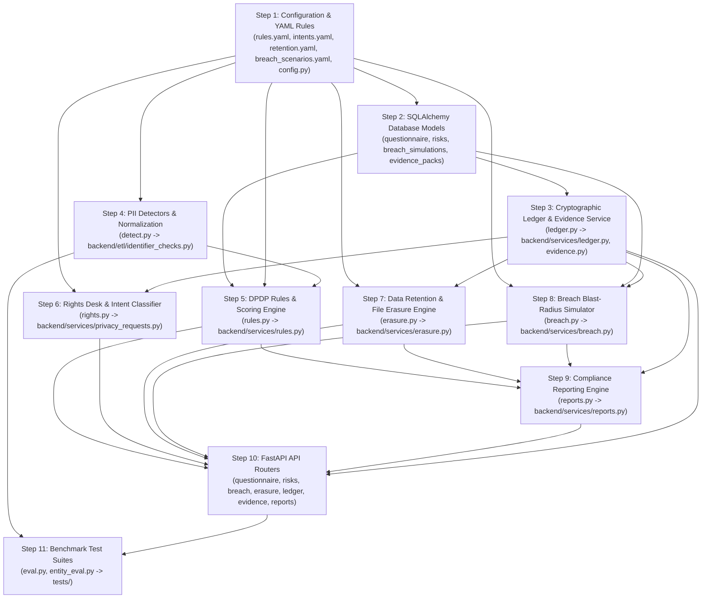

# Kavach Architecture Port Map: Flask Prototype to FastAPI Backend

This document maps all modules and assets in the `reference_mannat/app/` prototype to the production `backend/` codebase (FastAPI + SQLAlchemy 2.0 ORM + SQLite WAL + HMAC-SHA256).

---

## 1. Module Inventory & Porting Analysis

| File Path | What It Does | Overlapping `backend/` File | Flask Dependent? | Raw Values / Salt Usage | Recommendation |
| :--- | :--- | :--- | :--- | :--- | :--- |
| `reference_mannat/app/__init__.py` | Flask application factory (`create_app`), configures upload directory, database connection lifecycle, registers error handlers (413, 500), context processors, and blueprint. | `backend/main.py` | **YES** (`Flask`, `Blueprint`, `jsonify`, context processors) | Neither (bootstrap only). | **SKIP** FastAPI uses `backend/main.py` with lifespan handlers, CORS middleware, and APIRouters. |
| `reference_mannat/app/config.py` | Application constants: UI navigation page registry, DPDP response window (`RESPONSE_DAYS = 30`), breach timeline constants (Stage 1 without delay, Stage 2 within 72h), benchmark accuracy metadata. | `backend/config.py` | **NO** (Pure Python constants) | Neither. | **MERGE** Incorporate statutory constants (`RESPONSE_DAYS`, `BREACH_STAGE_2_HOURS`) into `backend/config.py`. |
| `reference_mannat/app/db.py` | Raw `sqlite3` database helper (`get_db`, `init_db`, `close_db`), table schema migration for ledger and sources, `PRAGMA foreign_keys = ON`. Attached to `flask.g`. | `backend/db/engine.py` `backend/db/models.py` | **YES** (Hooks into `flask.g`, `current_app`, `has_app_context`) | Neither. | **SKIP** `backend/db/engine.py` already manages SQLite connections with WAL, FK pragmas, and SQLAlchemy session management. |
| `reference_mannat/app/schema.sql` | Raw SQL DDL defining tables: `sources`, `rights_requests`, `ledger`, `evidence_packs`, `ledger_tamper_backup`, `findings`, `people`, `person_records`, `questionnaire`, `risks`, `breach_simulations`. | `backend/db/models.py` | **NO** (SQL script) | Uses SHA-256 hashes (`value_hash`, `name_hash`, `plan_hash`, `entry_hash`) and masked strings. Never stores raw PII. | **MERGE** Declare missing tables (`questionnaire`, `risks`, `breach_simulations`, `evidence_packs`, `ledger_tamper_backup`) as SQLAlchemy ORM models in `backend/db/models.py`. |
| `reference_mannat/app/ingest.py` | Multi-source streaming reader for `.xlsx` (openpyxl), `.csv` (csv.reader), and `.txt` (WhatsApp chat regex). Yields `(location, text, metadata)` with 10 MB size and 50k row limits. | `backend/etl/reader.py` `backend/etl/adapters.py` `backend/etl/cleaner.py` | **NO** (openpyxl + standard library) | In-memory stream only. Does not persist raw values. | **MERGE** `backend/etl/adapters.py` already supports CSV, XLSX, Google Forms, WhatsApp, JSON, and OCR. Align row locator conventions (`Sheet/R{n}/C{n}`). |
| `reference_mannat/app/detect.py` | Pure PII pattern matching: regex and Verhoeff algorithm for Indian identifiers (Aadhaar, PAN, phone, email, GSTIN, IFSC, UPI, DOB/minor calculation, bank account, name tokens, health terms). Functions for masking and hashing with salt. | `backend/etl/identifier_checks.py` `backend/security.py` `backend/services/provenance.py` | **NO** | Uses `KAVACH_SALT` or `data/.salt` with SHA-256. Never returns raw values from `_make_finding`; returns `masked_sample` and `value_hash`. | **MERGE** Our backend already uses HMAC-SHA256 (`backend/security.py`). Merge additional detector regexes (GSTIN, IFSC, UPI, health terms, minor calculation) into `backend/etl/identifier_checks.py`. |
| `reference_mannat/app/inventory.py` | Ingestion orchestrator (`scan_and_ingest_file`) and entity resolution (`run_entity_resolution`) using `UnionFind`. Links findings across sources into `people` and `person_records` via strong/probable matching. | `backend/services/provenance.py` `backend/services/inventory.py` `backend/etl/reconciler.py` | **NO** | Stores masked samples, `value_hash`, `name_hash`. No raw values in SQLite. | **MERGE** Entity resolution with Union-Find and HMAC matching was implemented in `backend/services/provenance.py` (K2). Port source-level inventory aggregation metrics. |
| `reference_mannat/app/rules.py` | DPDP compliance engine: parses `rules.yaml`, gathers facts from `questionnaire` and `findings`/`person_records`, evaluates logical condition tree without `eval()`, scores readiness (100 - severity deductions), and persists results to `risks`. | **none** | **NO** | Evaluates aggregated counts, boolean conditions, and questionnaire responses. No raw personal data. | **PORT AND ADAPT** Port condition evaluator and scoring engine into `backend/services/rules.py` using SQLAlchemy sessions and ORM models. |
| `reference_mannat/app/rules/rules.yaml` | Declarative definitions of 12 DPDP compliance rules (health data safeguards, Aadhaar in chat/files, minor data, employee lawful basis, CCTV, personal phones, vendor contracts, breach contact, retention policy, data sprawl) with citations and remediation. | **none** | **NO** | Rule definitions only. | **PORT AS IS** Copy YAML file directly to `backend/rules/rules.yaml`. |
| `reference_mannat/app/rules/intents.yaml` | Keyword dictionaries and regexes for classifying DPDP Data Principal rights requests (erase, access, correct, withdraw consent, complaint) across English, Hinglish, and Romanized Kannada. | `backend/ai_client/mock_client.py` `backend/services/privacy_requests.py` | **NO** | Keyword rules only. | **PORT AS IS** Copy YAML file directly to `backend/rules/intents.yaml` as deterministic fast-path / fallback classifier. |
| `reference_mannat/app/rules/retention.yaml` | Data retention policy matrix mapping sources and field categories to legal retention windows, statutory citations (NMC Act, IT Act, Companies Act), and disposal decisions (`ERASE`, `RETAIN`, `MASK`, `REVIEW`). | **none** | **NO** | Retention schedules and citation text only. | **PORT AS IS** Copy YAML file directly to `backend/rules/retention.yaml`. |
| `reference_mannat/app/rules/breach_scenarios.yaml` | 5 pre-configured breach simulation scenarios (staff laptop theft, WhatsApp chat backup leak, diagnostic billing ransomware, rogue vendor export, lost reception USB) with affected sources, exposure types, and defaults. | **none** | **NO** | Simulation scenario templates only. | **PORT AS IS** Copy YAML file directly to `backend/rules/breach_scenarios.yaml`. |
| `reference_mannat/app/rights.py` | Rights Desk intake pipeline: parses WhatsApp/chat exports, classifies message intent against `intents.yaml`, resolves sender to `people` record by phone/name hash, assigns 30-day statutory response clock, masks message excerpts, logs to ledger. | `backend/services/privacy_requests.py` `backend/api/privacy_requests.py` | **NO** | Masks sender and excerpts (`sender_masked`, `message_excerpt_masked`). Resolves sender via hashed identifiers. No raw values stored. | **MERGE** Incorporate WhatsApp chat message parsing and keyword intent classification into `backend/services/privacy_requests.py`. |
| `reference_mannat/app/erasure.py` | End-to-end erasure workflow: compiles field-level erasure plans from `retention.yaml`, supports manual field overrides, redacts tabular/text files on disk (`.xlsx`, `.csv`, `.txt`), verifies SHA-256 plan hash, executes post-erasure residual re-scan, logs to ledger, generates HTML/JSON compliance receipts. | **none** (`backend/services/privacy_requests.py` currently only toggles status) | **NO** | Reconstructs identifiers in-memory only during execution; never persists raw identifiers. Generates masked receipts and hashes plans with SHA-256. | **PORT AND ADAPT** Adapt disk redaction, residual re-scanner, and compliance receipt generator into `backend/services/erasure.py`. |
| `reference_mannat/app/breach.py` | Breach blast-radius simulator: computes affected record/principal counts, high-impact PII exposure, and minor involvement; scores severity; manages DPDP notification countdown clocks (Board without delay, 72h detailed report); generates intimation notice drafts; records runs in `breach_simulations` and logs to `ledger`. | `backend/services/incidents.py` `backend/api/incidents.py` | **NO** | Uses aggregate counts and category distributions; draft notices use sanitized placeholders (`[BUSINESS_NAME]`). No raw data stored. | **PORT AND ADAPT** Port blast-radius calculation, statutory notification clocks, and draft generator into `backend/services/breach.py` using SQLAlchemy models. |
| `reference_mannat/app/ledger.py` | Cryptographic append-only ledger: hash-chaining (`prev_hash`, `ts`, `type`, canonical JSON payload), genesis initialization, payload guard (`check_payload_guard`) blocking any PII from entering the ledger, cryptographic chain verification (`verify_chain`), tamper simulation (`tamper_ledger_event`), repair (`repair_ledger_event`), and evidence zip pack generation (`export_evidence_pack`). | `backend/db/models.py:LedgerEvent` | **NO** | Strict zero raw PII guard (`check_payload_guard` rejects any identifiers). Cryptographic SHA-256 chaining. | **PORT AND ADAPT** Port hash-chaining, tamper demo, verification, and evidence pack export into `backend/services/ledger.py` and `backend/services/evidence.py`. |
| `reference_mannat/app/reports.py` | Compliance readiness reporting: aggregates scan statistics, readiness score, triggered risks, questionnaire responses, rights requests, erasure receipts, and breach simulations; prioritizes up to 8 remediation actions; generates printable self-contained HTML compliance report. | **none** (`backend/etl/eda.py` only does basic tabular EDA) | **NO** | Aggregated compliance metrics and HTML report generation. No raw personal data. | **PORT AND ADAPT** Port summary aggregation and printable HTML report generator into `backend/services/reports.py`. |
| `reference_mannat/app/llm.py` | Empty 1-line placeholder (`# LLM wrapper (optional, with rule-based fallback)`). | `backend/ai_client/client.py` `backend/ai_client/mock_client.py` `backend/ai_client/ollama_client.py` | **NO** | Neither. | **SKIP** `backend/ai_client/` already provides a complete, tested Ollama and mock AI client for all 4 privacy tasks. |
| `reference_mannat/app/routes.py` | Flask blueprint with HTML view handlers and 35+ REST API endpoints covering upload, inventory, people, findings, questionnaire, risks, rights desk, erasure, breach simulation, ledger, tamper demo, evidence pack export, and reports. | `backend/api/inventory.py` `backend/api/privacy_requests.py` `backend/api/incidents.py` | **YES** (`Blueprint`, `render_template`, `request`, `jsonify`, `send_file`, `abort`) | Endpoint handlers delegate storage to services that enforce masking and HMAC hashing. | **PORT AND ADAPT** SKIP the Flask Jinja view routes (UI is separate). Port and adapt the REST endpoints into modular FastAPI `APIRouter`s under `backend/api/`. |
| `reference_mannat/app/eval.py` | CLI detector benchmark tool: evaluates precision, recall, and F1 across all PII categories against `data/demo/ground_truth.json` or `demo_hard`. | `tests/` | **NO** | Benchmark evaluation against ground truth; masks sample output in error logs. | **PORT AND ADAPT** Port into automated pytest integration tests in `tests/test_benchmark_detect.py` or a diagnostic utility script in `scripts/eval_detect.py`. |
| `reference_mannat/app/entity_eval.py` | CLI entity resolution benchmark tool: evaluates pairwise precision, recall, and F1 against `data/demo/people_truth.json`. | `tests/` | **NO** | Benchmark evaluation against ground truth; masks personal names and identifiers. | **PORT AND ADAPT** Port into automated pytest integration tests in `tests/test_benchmark_entity.py` or a diagnostic utility script in `scripts/eval_entity.py`. |

---

## 2. Summary of Recommendations

- **PORT AS IS (4 items)**:
  - `reference_mannat/app/rules/rules.yaml`
  - `reference_mannat/app/rules/intents.yaml`
  - `reference_mannat/app/rules/retention.yaml`
  - `reference_mannat/app/rules/breach_scenarios.yaml`
- **PORT AND ADAPT (7 items)**:
  - `reference_mannat/app/rules.py` $\rightarrow$ `backend/services/rules.py`
  - `reference_mannat/app/ledger.py` $\rightarrow$ `backend/services/ledger.py` & `backend/services/evidence.py`
  - `reference_mannat/app/erasure.py` $\rightarrow$ `backend/services/erasure.py`
  - `reference_mannat/app/breach.py` $\rightarrow$ `backend/services/breach.py`
  - `reference_mannat/app/reports.py` $\rightarrow$ `backend/services/reports.py`
  - `reference_mannat/app/routes.py` (API endpoints only) $\rightarrow$ FastAPI routers under `backend/api/`
  - `reference_mannat/app/eval.py` & `entity_eval.py` $\rightarrow$ `tests/` / `scripts/`
- **MERGE (5 items)**:
  - `reference_mannat/app/config.py` $\rightarrow$ `backend/config.py`
  - `reference_mannat/app/schema.sql` $\rightarrow$ `backend/db/models.py` (SQLAlchemy ORM models)
  - `reference_mannat/app/detect.py` $\rightarrow$ `backend/etl/identifier_checks.py` & `backend/security.py`
  - `reference_mannat/app/inventory.py` $\rightarrow$ `backend/services/provenance.py` & `backend/services/inventory.py`
  - `reference_mannat/app/rights.py` $\rightarrow$ `backend/services/privacy_requests.py`
- **SKIP (3 items)**:
  - `reference_mannat/app/__init__.py` (Flask bootstrap; superseded by `backend/main.py`)
  - `reference_mannat/app/db.py` (Raw sqlite3 wrapper; superseded by `backend/db/engine.py`)
  - `reference_mannat/app/llm.py` (Empty stub; superseded by `backend/ai_client/`)

---

## 3. Suggested Porting Order & Dependency Graph

The recommended porting sequence respects strict component dependencies. Core rule definitions and database models must exist before business services can execute, and all services must exist before exposing their corresponding FastAPI endpoints.

### Detailed Execution Sequence

1. **Step 1: Configuration & Static Rule Assets (No Dependencies)**
   - Copy `rules.yaml`, `intents.yaml`, `retention.yaml`, and `breach_scenarios.yaml` to `backend/rules/`.
   - Add statutory constants (`RESPONSE_DAYS = 30`, `BREACH_STAGE_2_HOURS = 72`) to `backend/config.py`.
2. **Step 2: Database Schema & ORM Models (Depends on Step 1)**
   - Define SQLAlchemy models in `backend/db/models.py` for:
     - `QuestionnaireAnswer` (`questionnaire` table)
     - `Risk` (`risks` table)
     - `BreachSimulation` (`breach_simulations` table)
     - `EvidencePack` (`evidence_packs` table)
     - `LedgerTamperBackup` (`ledger_tamper_backup` table)
     - Ensure existing `LedgerEvent` matches the required ledger columns (`ts`, `type`, `payload_json`, `prev_hash`, `hash`).
3. **Step 3: Cryptographic Ledger & Evidence Service (Depends on Step 2)**
   - Port `reference_mannat/app/ledger.py` to `backend/services/ledger.py` and `backend/services/evidence.py`.
   - Adapt `append_ledger`, `compute_entry_hash`, `check_payload_guard`, `verify_chain`, `tamper_ledger_event`, and `export_evidence_pack` to use SQLAlchemy sessions and `backend/security.py`.
4. **Step 4: PII Detectors & Validation (Depends on Step 1)**
   - Port regexes and validation for GSTIN, IFSC, UPI, DOB (minor calculation), and health terms from `detect.py` into `backend/etl/identifier_checks.py`.
   - Ensure all detected items continue to be masked and hashed via `backend/security.py`.
5. **Step 5: DPDP Rules & Scoring Engine (Depends on Steps 1, 2, 4)**
   - Port `reference_mannat/app/rules.py` to `backend/services/rules.py`.
   - Implement `collect_facts`, `evaluate_condition`, `evaluate_rules`, and questionnaire answer persistence against SQLAlchemy models.
6. **Step 6: Rights Desk Intake & Sender Resolution (Depends on Steps 1, 3)**
   - Incorporate `parse_whatsapp_text` and keyword/regex `classify_message` from `rights.py` into `backend/services/privacy_requests.py`.
   - Resolve senders to `people` records using HMAC hashes and connect to the ledger.
7. **Step 7: Retention Policy & File Erasure Engine (Depends on Steps 1, 3)**
   - Port `reference_mannat/app/erasure.py` to `backend/services/erasure.py`.
   - Implement plan compilation from `retention.yaml`, disk-level file redaction (`.xlsx`, `.csv`, `.txt`), residual re-scanning, ledger logging, and HTML/JSON receipt generation.
8. **Step 8: Breach Blast-Radius Simulator (Depends on Steps 1, 2, 3)**
   - Port `reference_mannat/app/breach.py` to `backend/services/breach.py`.
   - Implement scenario loading, blast-radius calculations, statutory DPDP notification clocks, intimation draft generation, simulation history persistence, and ledger logging.
9. **Step 9: Compliance Reporting Engine (Depends on Steps 3, 5, 7, 8)**
   - Port `reference_mannat/app/reports.py` to `backend/services/reports.py`.
   - Aggregate inventory, readiness score, risks, questionnaire answers, rights requests, erasure receipts, and breach simulations.
   - Generate prioritized remediation actions and self-contained printable HTML compliance reports.
10. **Step 10: FastAPI API Routers & Integration (Depends on Steps 3 through 9)**
    - Create or extend FastAPI APIRouters under `backend/api/`:
      - `backend/api/questionnaire.py` (`/api/questionnaire`)
      - `backend/api/risks.py` (`/api/risks`)
      - `backend/api/privacy_requests.py` (extend with `/api/rights/intake`, `/api/rights/classify`, `/api/rights/{id}/plan`, `/api/rights/{id}/execute`, `/api/rights/{id}/receipt`)
      - `backend/api/breach.py` (`/api/breach/scenarios`, `/api/breach/simulate`, `/api/breach/{id}`)
      - `backend/api/ledger.py` (`/api/ledger`, `/api/ledger/verify`, `/api/dev/tamper`, `/api/dev/repair`)
      - `backend/api/evidence.py` (`/api/evidence/export`, `/api/evidence/download/{pack_id}`, `/verify/{pack_id}`)
      - `backend/api/reports.py` (`/api/reports/summary`, `/api/reports/export`)
    - Register new routers in `backend/main.py`.
11. **Step 11: Benchmark Test Suites (Depends on Step 10)**
    - Adapt `eval.py` and `entity_eval.py` into automated pytest integration benchmarks (`tests/test_benchmark_detect.py`, `tests/test_benchmark_entity.py`).
