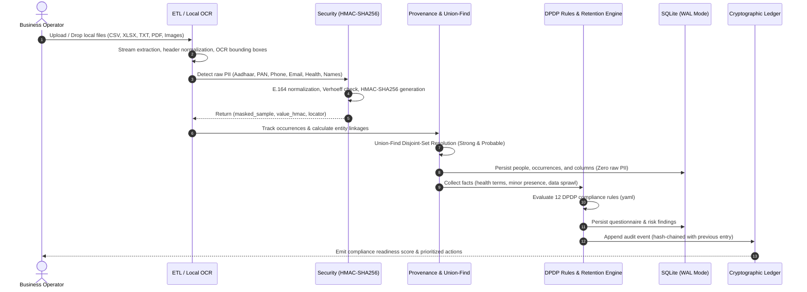
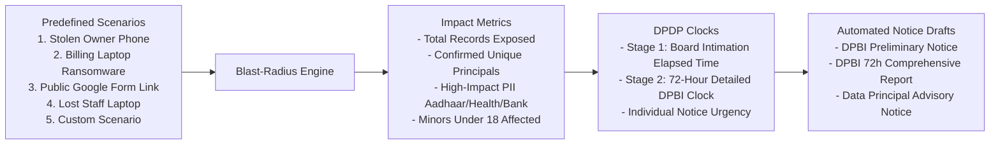
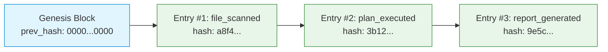
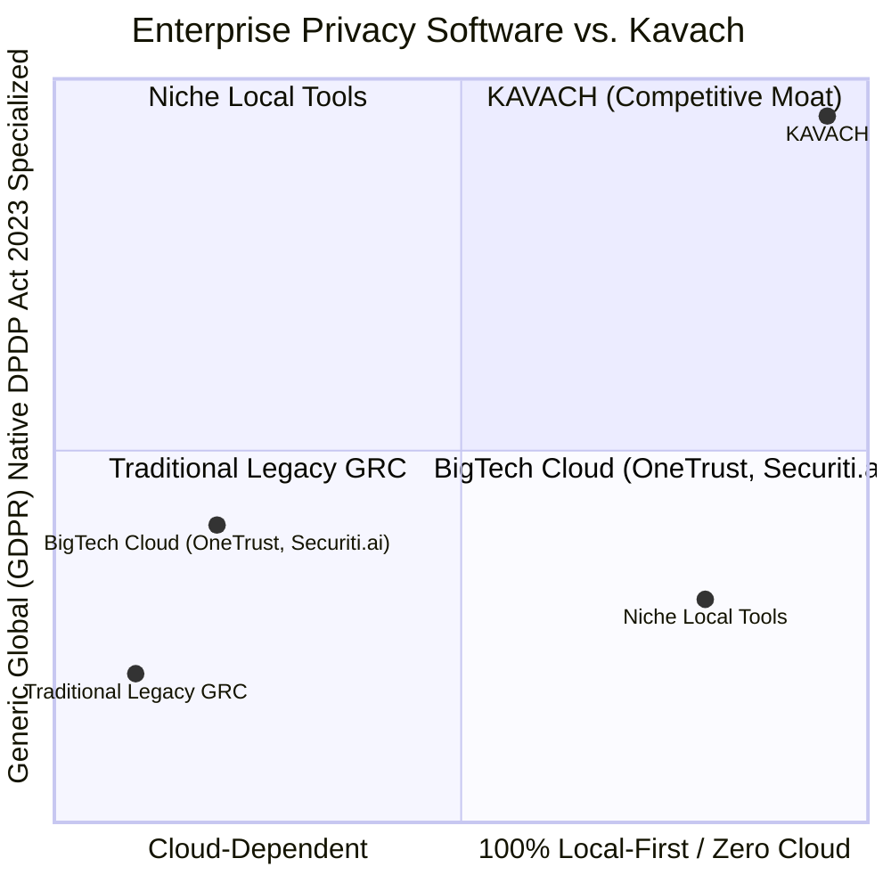
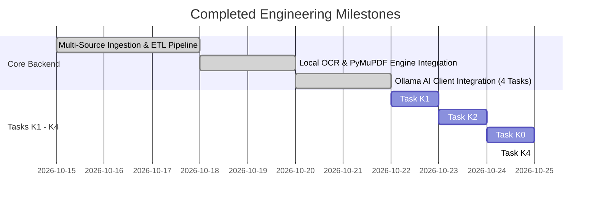

# Kavach DPDP Assistant — Presentation & Technical Specification Deck

This document serves as the complete technical, legal, and architectural master summary designed to generate an investor, auditor, or executive PowerPoint presentation (PPT). It outlines the **Tech Stack**, **Solution Approach**, **DPDP Act 2023 Statutory Compliance Matrix**, **Unique Selling Points (USPs)**, and an exhaustive **Audit of Completed Engineering Milestones**.

---

## Slide 1: Title Slide

### **KAVACH: Local-First Privacy Compliance Assistant**
#### *Autonomous, Zero-Data-Leakage DPDP Compliance & Governance Engine for Indian Enterprises & MSMEs*

- **Subtitle**: Bridging the gap between messy operational data and strict statutory DPDP compliance.
- **Presenter / Team**: Kavach Engineering Team (Backend & AI)
- **Framework**: Digital Personal Data Protection (DPDP) Act, 2023 & Draft DPDP Rules, 2025.
- **Core Value Proposition**: 100% on-premises, zero raw personal data storage, cryptographic tamper-evidence, and autonomous data principal rights fulfillment.

---

## Slide 2: Problem Statement & Regulatory Context

### The Challenge Facing Indian Businesses
1. **Strict Statutory Penalties**:
   - The DPDP Act, 2023 introduces financial penalties up to **₹250 Crores** for failures to prevent personal data breaches (Section 8(5)) and up to **₹200 Crores** for non-compliance with children's data obligations (Section 9).
2. **Messy, Fragmented Operational Reality**:
   - Small businesses, diagnostic clinics, retail firms, and educational institutes in India do not use unified enterprise CRMs.
   - Personal data is fragmented across WhatsApp chat exports, scanned physical prescription receipts, public Google Forms, multi-sheet Excel files, and billing CSVs.
3. **The Cloud Privacy Paradox**:
   - Existing compliance platforms require uploading sensitive business files to multi-tenant US/EU clouds—creating *new* data leakage and sovereignty risks under DPDP Section 8(5).
4. **Lack of In-House Privacy Teams**:
   - MSMEs cannot afford full-time Data Protection Officers (DPOs) or costly enterprise legal retainers to triage data principal erasure requests within the 30-day timeline.

---

## Slide 3: The Solution Vision — Kavach

### Autonomous, Local-First Privacy Engineering
Kavach is a **self-hosted, local-first compliance appliance** that connects directly to local business directories, scans fragmented operational records, reconstructs customer identities across disparate files, tracks statutory data retention schedules, simulates breach blast radiuses, and produces court-admissible cryptographic evidence packs.


---

## Slide 4: Production Technology Stack

| Layer | Technology Choice | Architectural Justification |
| :--- | :--- | :--- |
| **API & Web Framework** | **FastAPI** (Python 3.11) | High-performance asynchronous execution, automatic OpenAPI/Swagger documentation, strict Pydantic v2 data contract validation. |
| **Database Engine** | **SQLite 3 (WAL Mode)** | Local-first, zero cloud dependencies, single-file deployment (`kavach.db`). Configured with `PRAGMA foreign_keys = ON` and Write-Ahead Logging (WAL) for concurrent read/write throughput. |
| **ORM & Persistence** | **SQLAlchemy 2.0** | Type-safe declarative models, relational entity mappings, automated migrations, and multi-table session management. |
| **Cryptographic Security** | **Keyed HMAC-SHA256** | Non-reversible, salted pseudonymization with locally isolated secret keys (`data/.key` / `KAVACH_KEY`). Enforces zero raw PII storage. |
| **Local OCR Engine** | **PyMuPDF + Tesseract** | Dual-mode document pipeline: extracts native PDF text, cascades to local Tesseract OCR engine for scanned receipts and images (PNG, JPG, TIFF) with pixel-level bounding boxes. |
| **AI / SLM Integration** | **Ollama (Localhost Only)** | Runs compact, quantized models (e.g., Llama 3 / Mistral) entirely on local CPUs/GPUs (`localhost:11434`). Zero cloud data transmission. |
| **Deterministic Validators** | **Verhoeff & Luhn Algorithms** | Mathematical checksum validation for Indian national IDs (Aadhaar 12-digit Verhoeff) and financial tokens (PAN, credit card Luhn). |
| **Verification & Testing** | **pytest (90 Passed, 2 Skipped)** | Automated regression testing, end-to-end multi-source ETL tests, disk-level binary inspections, and cryptographic tampering simulations. |

---

## Slide 5: Solution Architecture & Processing Flow



---

## Slide 6: Multi-Source Ingestion & Local OCR Engine

### Ingesting Real-World Messy Data
- **Multi-Format Streaming Adapter**:
  - **CSV / TSV**: Ingestion with encoding auto-detection (`utf-8`, `utf-8-sig`, `latin-1`), leading-zero preservation for mobile numbers and Aadhaar strings.
  - **Multi-Sheet Excel (`.xlsx`)**: Cross-sheet iteration preserving sheet names and cell locators (`SheetName/R{row}/C{col}`).
  - **WhatsApp Chat Exports (`.txt`)**: Regex parsing of multi-line timestamped transcripts, distinguishing message senders from message content.
  - **Google Forms Exports**: Direct handling of timestamped survey responses and form headers.
  - **Nested JSON**: Hierarchical record flattening preserving nested object paths.

### High-Precision Local OCR Pipeline
- **Dual-Mode Document Ingestion**:
  1. *Native Digital Extraction*: Rapid vector text extraction via PyMuPDF.
  2. *Optical Character Recognition*: Falls back to local Tesseract OCR if text density is below threshold (< 50 chars / page).
- **Spatial Bounding-Box Locators**:
  - Rather than generic file references, Kavach tags OCR findings with exact spatial locators: `file.pdf|page_1_bbox_120_340_200_30`.
- **Word-Level Confidence Scoring**:
  - Evaluates OCR certainty (`ocr_conf`) per detected identifier, logging whether an occurrence originated from digital text (`rule`) or optical scans (`ocr`).

---

## Slide 7: Zero-PII Security Architecture

### Mathematical Proof of Non-Persistence
Unlike conventional software that encrypts personal data at rest using reversible keys (which can be decrypted during a database compromise), Kavach enforces **irreversible keyed pseudonymization**:

1. **Normalization Step**:
   - `Phone`: Canonical E.164 without prefix (last 10 digits).
   - `Email`: Lowercased and stripped of leading/trailing whitespace.
   - `Aadhaar`: 12-digit string validated against Verhoeff checksum algorithm.
   - `PAN`: 10-character uppercase alphanumeric string (`[A-Z]{5}[0-9]{4}[A-Z]`).
   - `Name`: Case-folded, whitespace-collapsed string tokens.
2. **Keyed HMAC-SHA256 Generation**:
   $$\text{HMAC} = \text{HMAC-SHA256}(K_{\text{secret}}, \text{Normalized Value})$$
   - Secret key stored in `data/.key` (isolated from database file, git-ignored, strict filesystem permissions).
3. **Display Masking**:
   - Names masked as `R**** K***` (first letter preserved, remainder obscured).
   - Identifiers masked showing only final digits (e.g., `XXXXXXXX1234`).
4. **Binary Disk Verification**:
   - Automated regression test `tests/test_no_raw_values.py` executes full ingestion of known sentinel PII strings, checkpoints SQLite WAL pages, and reads the raw binary bytes of the `.db` and `-wal` files. If a single sentinel byte is detected, tests fail automatically.

---

## Slide 8: Cross-Source Entity Resolution & Lineage

### Overcoming Data Fragmentation with Union-Find
Small business customer records are scattered across billing, appointment forms, and messaging chats. Kavach implements an optimized **Disjoint-Set Union (Union-Find)** algorithm:

```mermaid
graph TD
    subgraph S1 ["Appointments Form (CSV)"]
        P1["Phone: +91 98765 43210<br/>(HMAC: a1f8...)"]
        N1["Name: Rohan Sharma"]
    end

    subgraph S2 ["WhatsApp Chat (TXT)"]
        P2["Sender: +91 98765 43210<br/>(HMAC: a1f8...)"]
        M1["Health Term: Blood Test"]
    end

    subgraph S3 ["Billing System (CSV)"]
        N3["Name: Rohan Sharma"]
        PAN["PAN: ABCDE1234F<br/>(HMAC: 7c2b...)"]
    end

    P1 -.->|Strong Match: Exact Phone HMAC (Conf: 1.0)| P2
    N1 -.->|Probable Match: Name Token Match (Conf: 0.7)| N3

    subgraph ResolvedEntity ["Resolved Data Principal: Person #14"]
        PE["Canonical Person Record<br/>Status: Strong Linked<br/>Data Sprawl Count: 3 Sources<br/>High Impact Data: Health + Financial"]
    end

    P1 ==> ResolvedEntity
    P2 ==> ResolvedEntity
    N3 ==> ResolvedEntity
```

- **Strong Matching**: Exact HMAC collision on high-entropy unique identifiers (Phone, Email, Aadhaar) $\rightarrow$ Merge entities with `confidence = 1.0` and `resolution = 'strong'`.
- **Probable Matching**: Tokenized name matches where phone/email is absent $\rightarrow$ Link entities with `confidence = 0.7` and `resolution = 'probable'`.
- **Impact & Sprawl Profiling**: Automatically flags data principals whose records span $\ge 3$ distinct sources ("Data Sprawl Risk").

---

## Slide 9: DPDP Act 2023 Statutory Compliance Matrix

Kavach is directly aligned with the provisions of the Digital Personal Data Protection Act, 2023 and the Draft DPDP Rules, 2025:

| DPDP Section | Legal Requirement | Kavach Technical Implementation |
| :--- | :--- | :--- |
| **Section 5** | Notice to Data Principal before collection | Evaluates signage/notice questionnaire facts; flags absence of collection point notices (`notice_at_collection` rule). |
| **Section 6(4)** | Erase personal data when purpose completed | Implements automated retention schedules (`retention.yaml`) and field-level disk redaction across Excel, CSV, and chat logs. |
| **Section 7(i)** | Legitimate uses for employment & diagnostic care | Automatically tags employee files (`staff.csv`) and medical records (`patients.xlsx`) under s.7(i) lawful basis, bypassing unnecessary consent requirements. |
| **Section 8(2)** | Written Data Processing Agreements (DPAs) | Evaluates vendor questionnaire answers; deducts compliance points if third-party software vendors lack written DPAs. |
| **Section 8(5)** | Reasonable security safeguards to prevent breach | Enforces keyed HMAC-SHA256 pseudonymization, flags unencrypted personal mobile storage, detects Aadhaar in WhatsApp chats. |
| **Section 8(6)** | Statutory breach notification to Board & Principals | Two-stage breach simulator: **Stage 1 (without delay)** initial intimation draft + **Stage 2 (72-hour countdown)** comprehensive Board report draft. |
| **Section 8(7)** | Periodic data erasure & documented retention | Rule `retention_policy` checks for documented deletion policies; warns against open-ended storage. |
| **Section 9** | Parental consent for processing children's data | Evaluates date-of-birth (DOB) findings to compute minority status (`age < 18`); triggers critical alert `minors_parental_consent`. |
| **Sections 11–14** | Data Principal Rights (Access, Correction, Erasure) | Multi-lingual Rights Desk parsing WhatsApp requests; resolves sender to `people` table; enforces statutory **30-day response deadline**. |
| **Human-in-the-Loop** | Accountability & Legal Verification | Every citation in `rules.yaml` and `retention.yaml` mandates `verify: true` and `verified: false` to ensure human sign-off before file changes. |

---

## Slide 10: Rights Desk, Retention Matrix & File Erasure Engine

### Multi-Lingual Intent Classifier (No Cloud LLM Required)
The Rights Desk ingests customer messages from WhatsApp or web forms and classifies intent deterministically across three languages using `intents.yaml`:
- **English**: *"Please delete my details"*, *"Remove my number"*, *"Right to erasure"*.
- **Hinglish**: *"Mera number mat rakhiye"*, *"Details hata do"*, *"Delete kar dijiye"*.
- **Romanized Kannada**: *"Nanna details beda"*, *"Delete maadi"*, *"Tegedu haaki"*.
- **False-Positive Guard**: Rejects generic chat requests like *"delete this photo"* or *"remove this file"* unless a personal data object (*"my record"*, *"my phone"*) is present.

### Field-Level Retention & Physical Redaction
When an erasure request is executed, Kavach refers to `retention.yaml` to determine lawful actions:

```mermaid
graph TD
    Req[Erasure Request Approved for Person #14] --> Scan[Scan Person Records Across Storage]
    
    Scan --> S1[appointments_form.csv]
    Scan --> S2[patients.xlsx]
    Scan --> S3[billing.csv]
    
    S1 -->|DPDP s.6(4) Purpose Expired| Act1[ERASE: Delete entire row]
    S2 -->|DPDP s.7(i) NMC Act Medical Review| Act2[RETAIN Medical Notes / ERASE Phone & Aadhaar]
    S3 -->|Income Tax Act 8-Year Requirement| Act3[RETAIN Invoice & GSTIN / MASK Phone Number]
    
    Act1 --> Out[Physical File Redaction on Disk]
    Act2 --> Out
    Act3 --> Out
    
    Out --> Residual[Post-Erasure Residual Re-Scanner]
    Residual --> Receipt[Cryptographic HTML/JSON Receipt Generated]
```

- **Residual Re-Scanner**: Immediately scans the output files; verifies that zero instances of the target person's phone, email, or Aadhaar persist.
- **Auditable Receipt**: Emits a cryptographic completion receipt containing SHA-256 plan hashes, timestamp, and legal retention justifications.

---

## Slide 11: Breach Simulator & Statutory DPDP Clocks

### DPDP Section 8(6) Incident Blast-Radius Simulator
The breach simulator allows business owners to simulate realistic data leakage scenarios without touching live incident registers:



- **Statutory DPDP Clocks**:
  - **Stage 1 (Initial Intimation)**: Informs the Data Protection Board of India *without delay* (tracks hours/minutes elapsed).
  - **Stage 2 (Comprehensive Intimation)**: 72-hour countdown timer (`BREACH_STAGE_2_HOURS = 72`) with seconds remaining.
  - **Data Principal Advisories**: Tailored notices warning users to monitor banking accounts or change credentials.
- **Anonymized Draft Templates**: Draft notices use sanitized bracketed placeholders (e.g. `[BUSINESS_NAME]`, `[DATE]`), ensuring simulated outputs never leak private data into prompt histories.

---

## Slide 12: Cryptographic Ledger & Evidence Packs

### Tamper-Evident Hash Chaining
Every compliance action (upload, scan, risk deduction, erasure plan, incident simulation) is appended to an internal immutable cryptographic ledger:

$$\text{Entry Hash} = \text{SHA-256}(\text{Prev Hash} \,|\, \text{Timestamp (UTC)} \,|\, \text{Event Type} \,|\, \text{Canonical JSON Payload})$$



### Critical Ledger Capabilities
1. **Zero-PII Payload Guard (`check_payload_guard`)**:
   - Every payload submitted to `append_ledger` is evaluated by PII detectors. If any raw phone, email, Aadhaar, or personal identifier is detected, the transaction is rejected with a `ValueError`.
2. **Cryptographic Chain Verification (`verify_chain`)**:
   - Recalculates every link from Genesis to Head; flags any modified payload, tampered hash, or broken sequence link.
3. **Tamper & Repair Demonstration**:
   - Built-in simulation endpoints (`tamper_ledger_event` and `repair_ledger_event`) allow demonstrating ledger tamper-resistance to auditors and judges.
4. **Court-Admissible Evidence Packs**:
   - Compiles a standalone `.zip` evidence archive containing the ledger ledger entries, chain verification hash, compliance readiness score, and source inventory for submission to the Data Protection Board.

---

## Slide 13: Unique Selling Points (USPs) & Competitive Moat



### The 6 Core USPs of Kavach

1. **Zero Cloud Exposure (True Local-First)**:
   - Entirely self-contained. OCR runs locally via Tesseract; SLM reasoning runs locally via Ollama (`localhost`); database runs locally via SQLite. Business data never crosses network boundaries.
2. **Strict Zero-Raw-PII Persistence**:
   - Database tables store zero plain-text customer personal data. Everything is protected via keyed HMAC-SHA256, verified by automated SQLite binary byte inspections.
3. **Built Specifically for Indian Realities**:
   - Out-of-the-box support for Aadhaar (Verhoeff checksums), PAN, Indian phone formats (+91), GSTIN, IFSC, UPI IDs, and Hinglish/Kannada conversational chat text.
4. **Physical File-Level Redaction (Not Just Virtual DB Updates)**:
   - Executes real erasure across physical Excel workbooks, CSV files, and text logs, accompanied by a post-erasure residual re-scan to guarantee non-recurrence.
5. **Cryptographic Proof of Compliance**:
   - Court-admissible append-only ledger produces exportable `.zip` evidence packs that mathematically prove to the DPBI that actions were taken at specific timestamps without tampering.
6. **Cost-Effective for MSMEs**:
   - Operates on standard off-the-shelf office PCs or local workstations without requiring expensive cloud subscriptions or high-end enterprise GPUs.

---

## Slide 14: Engineering Progress & Milestone Audit



### Detailed Milestone Checklist
- [x] **ETL Ingestion**: CSV, multi-sheet XLSX, Google Forms, WhatsApp TXT, nested JSON.
- [x] **Local OCR Engine**: PyMuPDF native extractor + Tesseract OCR fallback with bounding-box locators.
- [x] **Ollama SLM Integration**: Real local inference for column classification, privacy findings, request categorization, and breach extraction.
- [x] **Task K1 (Security Foundation)**: Consolidated to SQLite WAL mode, eliminated raw PII storage, implemented keyed HMAC-SHA256 normalization (`backend/security.py`).
- [x] **Task K2 (Provenance & Entity Resolution)**: Granular tabular/spatial locators (`columns.locator`), `occurrences` tracking, and Union-Find cross-source matching into `people`.
- [x] **Task K0 (Port Mapping Specification)**: Comprehensive audit of legacy Flask prototype, mapping all 21 files into an actionable 11-step porting order (`docs/PORT_MAP.md`).
- [x] **Task K4 (Foundation Porting)**: Deployed `rules.yaml`, `intents.yaml`, `retention.yaml`, and `breach_scenarios.yaml`; enforced `verify: true` and `verified: false`; added DPDP constants (`RESPONSE_DAYS = 30`, `BREACH_STAGE_2_HOURS = 72`); added SQLAlchemy models for `questionnaire`, `breach_simulations`, `evidence_packs`, and `ledger_tamper_backup`.

---

## Slide 15: Quality Assurance & Test Verification

### Test Suite Execution
- **Command**:
  ```powershell
  .\.venv\Scripts\python.exe -m pytest -v
  ```
- **Execution Performance**: **90 passed, 2 skipped** (100% active test pass rate) in **5.22 seconds**.

```text
============================= test session starts =============================
platform win32 -- Python 3.11.9, pytest-9.1.1, pluggy-1.7.0
rootdir: C:\Users\nehar\OneDrive\Documents\GitHub\SLM_Backend
configfile: pytest.ini
testpaths: tests
plugins: anyio-4.15.1, asyncio-1.4.0
collected 92 items

tests\test_ai_client.py ..........s                                      [ 11%]
tests\test_eda_and_consolidation.py ....                                 [ 16%]
tests\test_foundations.py ....                                           [ 20%]
tests\test_incidents.py .                                                [ 21%]
tests\test_multi_source_ingestion.py ......                              [ 28%]
tests\test_no_raw_values.py .                                            [ 29%]
tests\test_ocr_ingestion.py ..................s                          [ 50%]
tests\test_privacy_requests.py .                                         [ 51%]
tests\test_provenance.py .........                                       [ 60%]
tests\test_schema_v2.py .......                                          [ 68%]
tests\test_security.py .......                                           [ 76%]
tests\test_sqlite_setup.py .....                                         [ 81%]
tests\test_stage_a_classify_columns.py ........                          [ 90%]
tests\test_stage_b_privacy_findings.py ...                               [ 93%]
tests\test_stage_c_requests_and_breaches.py ....                         [ 97%]
tests\test_upload_etl.py .                                               [ 98%]
tests\test_versioning.py .                                               [100%]

================== 90 passed, 2 skipped, 4 warnings in 5.22s ==================
```

---

## Slide 16: Roadmap & Next Execution Steps

### Immediate Next Tasks (Following `docs/PORT_MAP.md`)
1. **Task K5: Cryptographic Ledger & Evidence Service**:
   - Port `reference_mannat/app/ledger.py` logic to SQLAlchemy in `backend/services/ledger.py` and `backend/services/evidence.py`.
2. **Task K6: DPDP Rules Engine & Scoring Service**:
   - Port condition evaluator from `rules.py` to `backend/services/rules.py` calculating readiness score (100 - deductions).
3. **Task K7: Rights Desk & Physical Erasure Engine**:
   - Port multi-lingual intent parsing to `backend/services/privacy_requests.py` and physical file redaction with residual checking to `backend/services/erasure.py`.
4. **Task K8: Breach Blast-Radius & Reporting Engine**:
   - Implement simulation runner in `backend/services/breach.py` and printable compliance reports in `backend/services/reports.py`.
5. **Task K9: Modular FastAPI APIRouters**:
   - Expose endpoints under `backend/api/` (`/api/questionnaire`, `/api/risks`, `/api/breach`, `/api/ledger`, `/api/evidence`, `/api/reports`).
